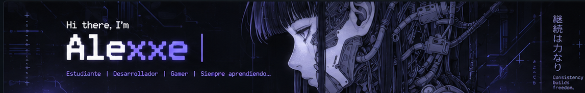
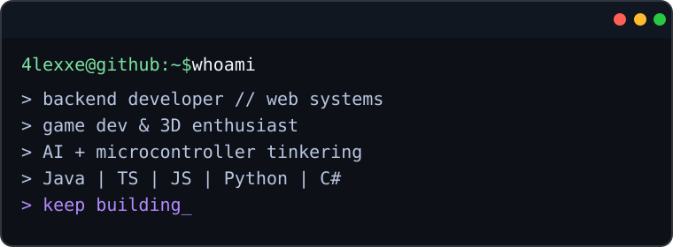
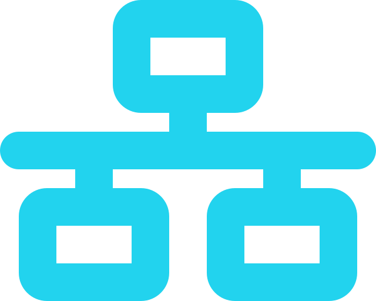
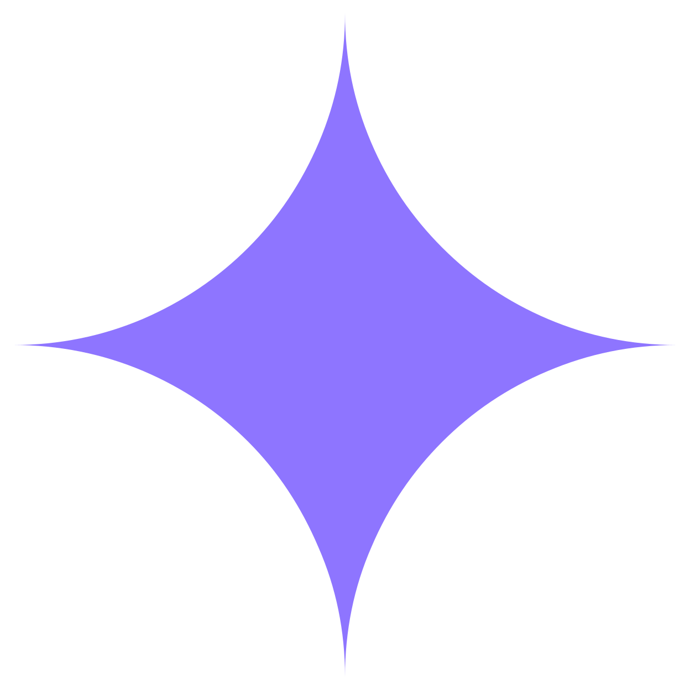
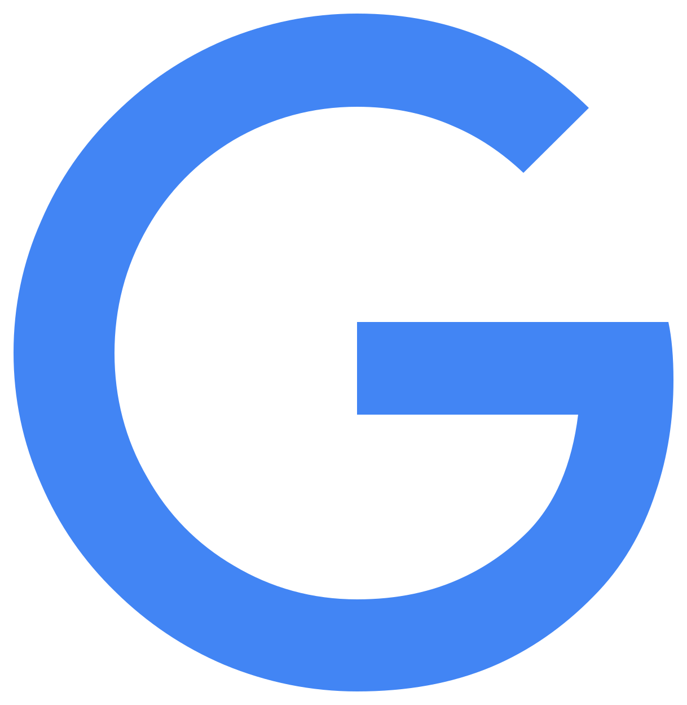
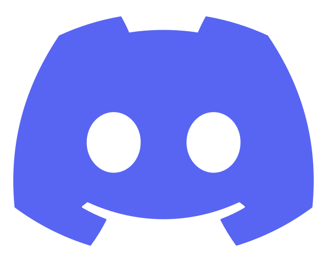

<!-- Perfil GitHub 4lexxe | Tema: Portfolio técnico · Dark / Violet -->

  

  <h2>Software Development · Web · Game Development</h2>

  

    Me interesa convertir ideas en productos: desde APIs y plataformas web hasta experiencias interactivas, videojuegos y prototipos con hardware.
  

  

  

    <a href="#perfil">Perfil</a> &nbsp;·&nbsp;
    <a href="#tecnologías">Tecnologías</a> &nbsp;·&nbsp;
    <a href="#proyectos-destacados">Proyectos</a> &nbsp;·&nbsp;
    <a href="#actividad-en-github">Actividad</a> &nbsp;·&nbsp;
    <a href="#intereses-personales">Intereses</a> &nbsp;·&nbsp;
    <a href="#contacto">Contacto</a>
  

---

## 👤 Perfil

<table width="100%">
  <tr>
    <td width="57%" valign="top">
      
Soy desarrollador enfocado en aplicaciones web, backend y diseño de soluciones de software. También disfruto explorar el desarrollo de videojuegos, gráficos 3D y tecnología aplicada a proyectos propios.

      
Mi formación combina <strong>Ingeniería Informática</strong> y <strong>Diseño de Videojuegos</strong>, con interés en arquitectura de sistemas, trabajo colaborativo y aprendizaje continuo.

      
<strong>Áreas de interés:</strong> software backend, interfaces web, experiencias interactivas y experimentación con IA y microcontroladores.

    </td>
    <td width="43%" valign="middle" align="center">
      
    </td>
  </tr>
</table>

---

## 🧰 Tecnologías

Lenguajes, frameworks y herramientas con los que trabajo o experimento.

<table width="100%">
  <tr>
    <td width="50%" valign="top">
      <h3>Lenguajes</h3>
      
      
      
      
      
    </td>
    <td width="50%" valign="top">
      <h3>Desarrollo web y backend</h3>
      
      
      
      
      
    </td>
  </tr>
  <tr>
    <td width="50%" valign="top">
      <h3>Datos e infraestructura</h3>
      
      
      
      
      
      
      
 <strong>Redes y conectividad</strong>

    </td>
    <td width="50%" valign="top">
      <h3>Videojuegos, 3D y creatividad</h3>
      
      
      
      
 <strong>ESP32</strong> · prototipos y microcontroladores

      <h4>Herramientas de IA</h4>
      

         <strong>Gemini</strong>
        &nbsp;&nbsp;
         <strong>Project Astra</strong>
      

    </td>
  </tr>
</table>

---

## 🚀 Proyectos destacados

<table width="100%">
  <tr>
    <td width="50%" valign="top">
      <h3><a href="https://github.com/4lexxe/DevsProject">DevsProject ↗</a></h3>
      
Plataforma colaborativa para desarrolladores, proyectos y equipos.

      
      
    </td>
    <td width="50%" valign="top">
      <h3><a href="https://github.com/4lexxe/API_RESTful">API RESTful ↗</a></h3>
      
Aplicación con servicios en Node.js y Express, y frontend en Angular.

      
      
    </td>
  </tr>
  <tr>
    <td width="50%" valign="top">
      <h3><a href="https://github.com/4lexxe/EduNodo_backend">EduNodo Backend ↗</a></h3>
      
Backend de una plataforma educativa digital (LMS), con arquitectura multi-tenant.

      
      
    </td>
    <td width="50%" valign="top">
      <h3><a href="https://github.com/4lexxe/3d_bot_threejs">3D Bot · Three.js ↗</a></h3>
      
Prototipo 3D interactivo para explorar modelos y animaciones en la web.

      
      
    </td>
  </tr>
</table>

<a href="https://github.com/4lexxe?tab=repositories">Explorar todos los repositorios →</a>

---

## 📊 Actividad en GitHub

  
  
  
<a href="https://github.com/4lexxe?tab=overview">Ver contribuciones en GitHub →</a>

---

## 🎮 Intereses personales

<table width="100%">
  <tr>
    <td width="50%" valign="top">
      <h3>Videojuegos</h3>
      
En mi tiempo libre juego a <strong>Counter-Strike 2</strong> y <strong>Overwatch</strong>.

       <strong>Counter-Strike 2</strong>
       
      <strong>Overwatch</strong> 🎮
    </td>
    <td width="50%" valign="top">
      <h3>Proyectos personales</h3>
      
Experimento con <strong>ESP32</strong>, hardware, redes, Linux y herramientas de IA, combinando programación y creatividad.

       <strong>ESP32 y electrónica</strong>
    </td>
  </tr>
</table>

---

## 🤝 Contacto

  
  
  
   <strong>Discord</strong>

  <!-- Discord: al facilitar el enlace personal, reemplazar el ícono anterior por un enlace a tu usuario/perfil/servidor. -->

 

  
  
Alexxe · Código, creatividad y aprendizaje continuo

